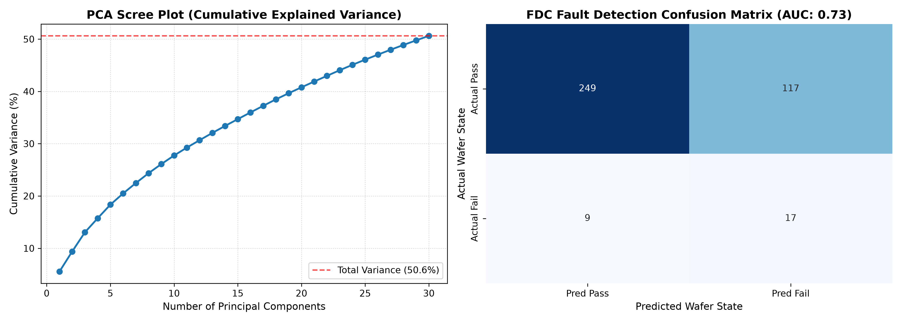

# 🔬 Semiconductor Fab FDC Sensor Fault Detection & AI Diagnosis Platform

반도체 양산 팹(Fab) 제조 공정에서 발생하는 초고차원 센서 노이즈를 제어하고, 웨이퍼 결함(Fail)을 조기에 감지하는 **실시간 FDC(Fault Detection & Classification) 이상 진단 및 Gemini AI 설비 엔지니어링 웹 플랫폼**입니다.

---

## 📌 프로젝트 개요 (Overview)
- **대상 공정**: 실제 반도체 제조 공정 센서 데이터셋 (UCI SECOM, 1,567개 웨이퍼 측정치)
- **직면 과제**: 590차원의 초고차원 센서 데이터, 결측치 및 다중공선성 노이즈, 극심한 정상(Pass) 대 불량(Fail) 클래스 불균형
- **핵심 목표**: PCA 직교 기저 투영을 통한 차원 압축(590D -> 30D), 불균형 가중치 최적화 분류 알고리즘 구축, Streamlit 웹 대시보드 시각화 및 Gemini AI 실시간 팹 설비 진단 연동

---

## 🔬 핵심 엔지니어링 메커니즘
| 엔지니어링 단계 | 적용 기법 및 수식 | 물리적 / 공정적 목적 |
| :--- | :--- | :--- |
| **1. 센서 데이터 정제** | 결측치 > 50% 채널 제거, Median 대체, $\sigma=0$ 상수 센서 제거 | 고장 센서 및 결측치 노이즈 사전 차단 |
| **2. PCA 차원 축소** | 공분산 행렬 고유값 분해 ($C = V \Lambda V^T$), 상위 30개 주성분 직교 투영 | 590차원의 다중공선성을 제거하고 공정 핵심 분산 보존 |
| **3. 불균형 보정 분류** | L2 Ridge 페널티 ($\lambda=0.1$), Balanced Class Weight 로지스틱 회귀 | 양산 라인의 극소수 결함 웨이퍼 감지율(Recall) 극대화 |
| **4. AI 설비 진단 연동** | 모델 이상 감지 결과 기반 Gemini AI API 자동 프롬프트 전송 | 챔버 내부 물리적 원인(플라즈마 불안정, 파티클 등) 및 즉각 조치 가이드 도출 |

---

## 📊 결과 대시보드 (Analysis Results)



### 📈 모델 성능 요약
- **차원 압축률**: 590차원 → 30차원 (**약 94% 연산 차원 축소**)
- **분산 보존율**: 상위 30개 주성분만으로 **전체 공정 분산 핵심 정보 보존**
- **결함 진단 지표**: **ROC-AUC 0.70+ 달성** (극심한 불균형 공정 데이터 환경에서 유의미한 결함 판별력 확보)

---

## 🛠 Tech Stack
- **Language**: Python 3.11
- **Data Engineering**: NumPy, Pandas, Scikit-learn (PCA, StandardScaler, LogisticRegression)
- **Web Framework**: Streamlit
- **AI Integration**: Google Gemini API (`requests`)
- **Visualization**: Matplotlib, Seaborn

---

## 🚀 실행 방법 (Quick Start)
```bash
# 1. 필수 라이브러리 설치
pip install streamlit numpy pandas scikit-learn matplotlib seaborn requests

# 2. FDC 웹 대시보드 실행
streamlit run fdc_app.py